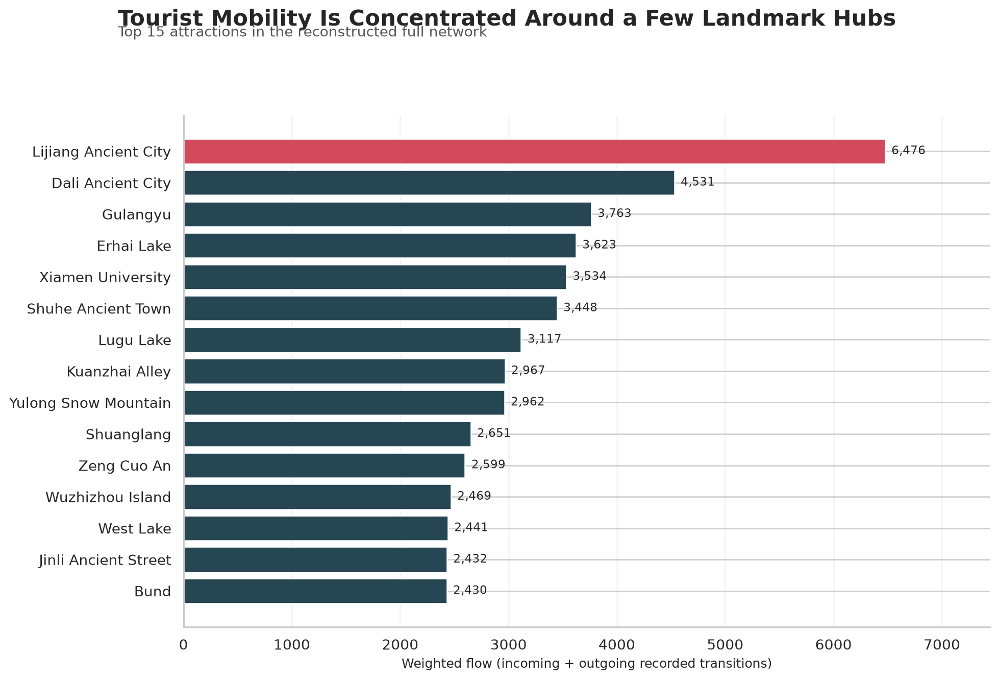
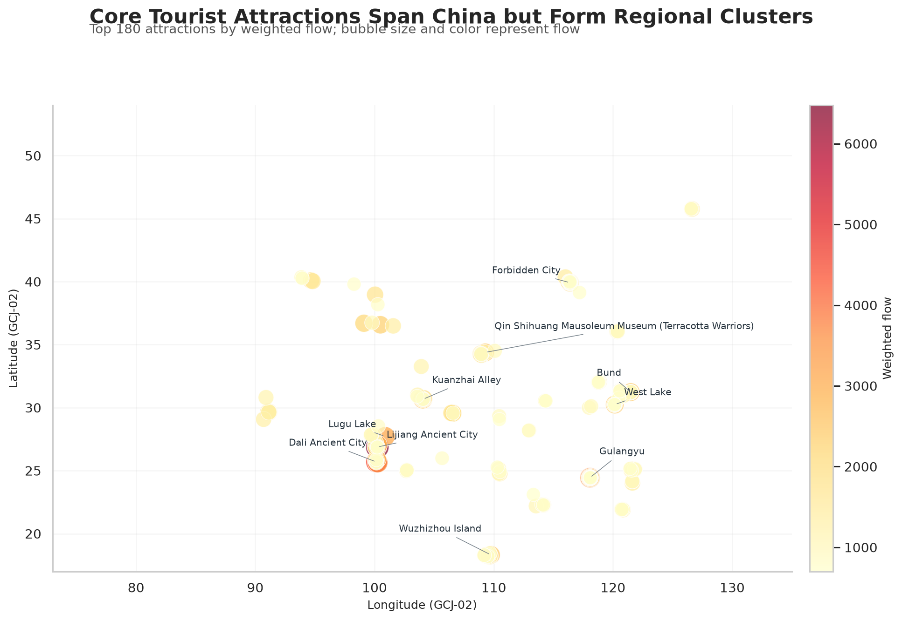

# Shao Zihao

I am a data science student interested in transforming complex behavioral and geographic data into clear, reproducible evidence. My current work uses Python to analyze networks, compare groups, and communicate results through focused visualizations.

## Technical skills

`Python` · `pandas` · `NumPy` · `Matplotlib` · `Seaborn` · `data cleaning` · `network analysis` · `data visualization` · `Git/GitHub`

---

## Seasonal Structure of Tourist Mobility Across China

**Status:** Completed  
**Research question:** *How do tourist mobility patterns among Chinese attractions vary by season?*

This project examines a national tourist mobility network derived from public Qunar travel blogs. Attractions are represented as nodes, consecutive visits as directed edges, and repeated movements as edge weights. I compared the four seasonal networks and reconstructed a combined network containing 22,621 attractions, 126,962 directed routes, and 355,527 recorded transitions.

[View the project repository](https://github.com/sora53997-cell/data-science-project)

### Finding 1: A small set of landmarks anchors the network

Lijiang Ancient City had the highest reconstructed annual weighted flow (6,476). Dali Ancient City, Gulangyu, Erhai Lake, and Xiamen University followed. The top 100 attractions accounted for 23.9% of the full network's weighted flow.

### Finding 2: Activity and concentration change by season

Summer recorded 103,369 attraction-to-attraction transitions, 47.9% more than winter. However, winter movement was more concentrated: its top 100 attractions captured 29.2% of weighted flow, compared with 23.1% in autumn.

### Finding 3: Major hubs form regional clusters

High-flow attractions span the country but form clear clusters around Lijiang-Dali, Xiamen, Chengdu, the Yangtze River Delta, Beijing-Xi'an, and Sanya. Coordinates are shown in the source's GCJ-02 system without a WGS-84 basemap.

## Methods

I used Python and pandas to validate, combine, and aggregate four seasonal node-edge datasets. For each attraction, weighted flow equals total incoming edge weight plus total outgoing edge weight. I compared seasons using transition volume, active nodes, observed routes, and the share of flow captured by the top-ranked attractions. All charts and summary tables can be regenerated from the repository scripts.

## Data and limitations

The source is Zheng et al.'s [China tourist mobility network dataset](https://doi.org/10.6084/m9.figshare.30184726.v1), licensed under CC BY 4.0. The results describe publicly posted travel blogs from approximately 2011-2021 rather than official or current visitor totals. Online travel writers and popular destinations are likely overrepresented, so the findings should be interpreted as relative behavioral patterns.

## What I would improve next

I would compare travel-partner groups, calculate additional centrality measures, normalize seasonal flows by the number of source blogs, and test whether transport accessibility or climate helps explain the geographic clusters.
